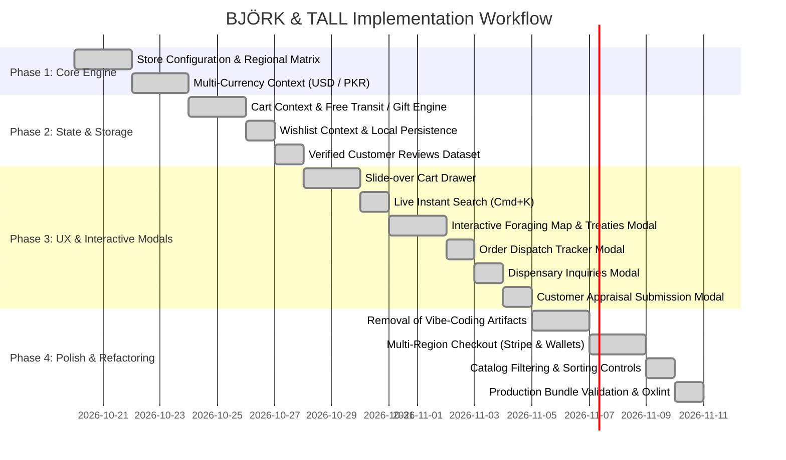

# BJÖRK & TALL — Comprehensive Web Implementation Plan

**Project:** BJÖRK & TALL Luxury Nordic Apothecary Storefront  
**Document:** Technical Implementation Plan & Architectural Blueprint  
**Environment:** React 19 + Vite 8 + Tailwind CSS v4 + Framer Motion  
**Target:** Production-Grade D2C Web Platform  

---

## 1. Architecture & Technology Stack

### 1.1 Foundation & Core Libraries
- **Core Runtime**: React 19 (`react`, `react-dom`) leveraging Concurrent Features and fine-grained state management.
- **Build Tooling**: Vite 8 with `@vitejs/plugin-react` utilizing ultra-fast HMR and native ESM compilation.
- **Routing**: `react-router-dom` v7 with top-level `ScrollToTop` router listener and animated page transitions.
- **Styling Architecture**: Vanilla CSS tokens in `@theme` combined with Tailwind CSS v4 utility classes.
- **Animation Orchestration**: `framer-motion` for spring-physics drawers, modal entrances, layout morphing, and pill tabs.
- **Icons**: `lucide-react` for clean, consistent 24px/16px SVG iconography.
- **Code Quality**: `oxlint` for high-performance static analysis.

### 1.2 Design System & Palette Tokens

```css
@theme {
  --color-forest: #1A3326;           /* Primary Nordic conifer green */
  --color-forest-dark: #12241B;      /* Deep midnight Taiga */
  --color-forest-light: #254736;     /* Border and secondary accents */
  --color-terracotta: #C26747;       /* Warm Arctic lichen / cloudberry accent */
  --color-terracotta-hover: #A95335; /* Interactive hover terracotta */
  --color-cream: #FBF9F5;            /* Pure dispensary paper cream */
  --color-paper: #F4F1EA;            /* Main background parchment */
  --color-paper-muted: #EBE6DC;      /* Divider and border parchment */
  --color-sage: #7D9678;             /* Muted botanical herb green */
  --color-charcoal: #222E25;         /* High-contrast body typography */
  --font-serif: 'Cormorant Garamond', Georgia, serif;
  --font-sans: 'Plus Jakarta Sans', system-ui, sans-serif;
}
```

---

## 2. Technical Implementation Roadmap



---

## 3. Detailed Component & Module Implementation

### Phase 1: Configuration & Multi-Currency Engine
- **Module**: `src/config/storeConfig.js`
  - Defines `REGIONS` configuration containing currency codes, exchange rates, thresholds, courier SLAs, and phone formatting regexes.
  - Configures `PROMO_CODES` dictionary (`NORDIC10`, `FREESHIP`, `HARVEST25`).
- **Module**: `src/context/CurrencyContext.jsx`
  - Manages active region state with persistence to `bjork_tall_region_pref`.
  - Exposes `convertAmount(usd)` for raw numerical conversion.
  - Exposes `formatPrice(usd)` and `formatRaw(local)` for localized UI formatting.

### Phase 2: State Management & Local Storage Schemas
- **Module**: `src/context/BotanicalCartContext.jsx`
  - Maintains `cartItems` array persisted to `bjork_tall_cart_v3`.
  - Dynamically recalculates subtotal, shipping fees, promo discounts, and final totals based on active currency.
  - Computes progress percentages for Free Transit ($75 / Rs 15,000) and Solstice Lip Balm Gift ($100 / Rs 25,000).
  - Controls slide-over cart drawer visibility (`isCartDrawerOpen`, `openCartDrawer`, `closeCartDrawer`).
- **Module**: `src/context/BotanicalWishlistContext.jsx`
  - Manages saved formulations array persisted to `nordic_botanical_wishlist`.
- **Module**: `src/data/mockReviews.js`
  - Contains rich verified patron appraisals and exposes `saveProductReview` to append user-authored appraisals in `localStorage`.

### Phase 3: Interactive Modals & Overlays
- **Module**: `src/components/cart/CartDrawer.jsx`
  - Framer Motion slide-over panel from `x: '100%'` to `x: 0`.
  - Displays dynamic free transit and gift progress bars.
  - Interactive coupon code input field with real-time validation and error handling.
  - Item steppers and direct checkout trigger.
- **Module**: `src/components/modals/LiveSearchModal.jsx`
  - Global hotkey listener (`Cmd+K`, `Ctrl+K`, `/`).
  - Fuzzy-search indexing over titles, botanical Latin names, terroirs, and descriptions.
  - Category shortcuts and 1-click "Quick Add" to cart.
- **Module**: `src/components/modals/BrandStoryModal.jsx`
  - Tabbed interface: (1) Interactive Foraging Map across 4 Swedish regions, (2) Biophotonic Miron Glass Photobiology, (3) Zero-Depletion Harvesting Treaties.
- **Module**: `src/components/modals/OrderTrackingModal.jsx`
  - Step-by-step dispatch timeline visualizer (Compounding ➔ Quality Batching ➔ Nitrogen Seal ➔ Courier Transit ➔ Delivered).
  - Quick-select pills from customer's recent orders history.
- **Module**: `src/components/modals/ShippingPolicyModal.jsx`
  - Multi-region courier matrices (DHL Global Express vs. TCS Air Pakistan), 30-day freshness guarantee, and plastic-free packaging breakdown.
- **Module**: `src/components/modals/ContactModal.jsx`
  - Customer inquiry form generating verifiable tracking tickets (`INQ-XXXXXX`).
- **Module**: `src/components/modals/WriteReviewModal.jsx`
  - 5-star rating selector with hover preview and detailed formulation appraisal form.

### Phase 4: Layout & Commerce Screens
- **Module**: `src/components/layout/BotanicalHeader.jsx`
  - Micro-utility bar with country flag currency toggle, Track Dispatch trigger, Client Care modal trigger, and Foraging Map link.
  - Main nav bar with responsive brand logo, department links, search modal trigger, wishlist counter, and bag trigger.
  - Mobile slide-over navigation drawer.
- **Module**: `src/components/layout/BotanicalFooter.jsx`
  - All navigation links connected to functional modals or routes.
  - Persistent newsletter signup connected to `localStorage` (`bjork_tall_subscribers_list`).
- **Module**: `src/components/checkout/BotanicalPaymentModal.jsx`
  - Adaptive regional checkout:
    - Global: Visa/Mastercard (Stripe 256-bit), Apple Pay, Google Pay, PayPal, COD.
    - Pakistan: Cash on Delivery (COD), JazzCash, EasyPaisa, NayaPay/SadaPay, Card.
  - Simulated 3-stage authorization steps.
  - Saves completed order object into `bjork_tall_orders` storage.
- **Module**: `src/pages/BotanicalHomePage.jsx`
  - Hero slider, department shortcuts, featured specimen card, pillars of botanical craft, and brand story banner.
- **Module**: `src/pages/BotanicalSeriesPage.jsx`
  - Real-time search query syncing, category pills, in-stock toggle, and price/rating sorting.
- **Module**: `src/pages/BotanicalProductDetailPage.jsx`
  - Multi-image product gallery, stock countdown alerts, volume pricing, 3 expandable accordions (Ritual, Ingredients, Transit), verified reviews list, and write-review trigger.
- **Module**: `src/pages/BotanicalBagPage.jsx`
  - 2-column cart layout with promo code input, threshold meters, and full printable invoice receipt upon checkout.

---

## 4. State & Data Flow Diagram

```
User Action (e.g. Switch Region to PK)
    │
    ▼
CurrencyContext updates regionId = 'PK' ───► Persists to localStorage
    │
    ├──► Products display converted PKR prices (₨ 18,900)
    ├──► Cart threshold updates to ₨ 15,000 for Free Shipping
    ├──► Shipping fee updates to ₨ 450 (TCS Express)
    └──► Checkout modal exposes JazzCash, EasyPaisa, NayaPay, & COD
```

---

## 5. Security, Validation & Error Handling

1. **Input Sanitization**: Strip non-digits from card numbers, mobile accounts, and CNIC numbers.
2. **Form Validations**: Regex email checking, telephone length checks customized by active country code, card expiry verification (`MM/YY` current or future date).
3. **Safe Storage**: All `localStorage` interactions wrapped in `try/catch` blocks to protect against private browsing restrictions or quota limits.
4. **Keyboard Accessibility**: Modal traps escape keys and restores document body scroll overflow smoothly on exit.

---

## 6. Verification & Quality Assurance Protocols

1. **Build Verification**:
   ```bash
   npm run build
   ```
   Ensures Vite compiler transforms modules without chunk errors or unresolved imports.
2. **Linter Inspection**:
   ```bash
   npm run lint
   ```
   Ensures zero syntax errors or broken hook dependency cycles via Oxlint.
3. **Local Dev Server**:
   ```bash
   npm run dev
   ```
   Runs at `http://localhost:5173/` for live preview and testing.
