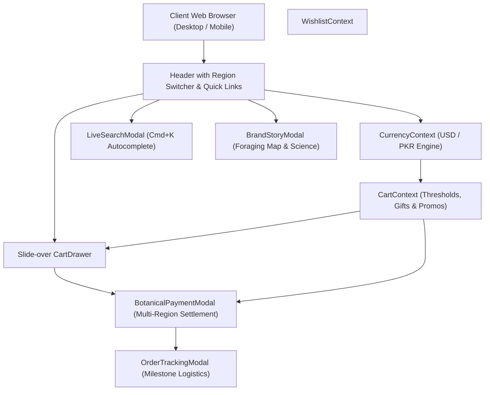

# BJÖRK & TALL — Product Requirements Document (PRD)

**Document Version:** 2.0.0  
**Status:** Approved & Implemented  
**Author:** Lead Product Architect & Engineering Team  
**Last Updated:** October 2026  
**Repository:** `NoumaArshad122/Bjrok-and-Tail-`  

---

## 1. Executive Summary & Brand Philosophy

**BJÖRK & TALL** is an artisanal Nordic botanical dispensary and luxury apothecary specializing in hand-harvested wildcraft elixirs, conifer resin salves, cold-pressed seed oils, and restorative forest teas sourced from the subarctic taiga of Swedish Lapland (68°N) and coastal Sweden.

Every formulation is compounded according to historical Scandinavian herbal wisdom and modern biological photobiology standards, packaged exclusively in biophotonic Miron violet glass.

The digital storefront represents a **hybrid global luxury direct-to-consumer (D2C) platform** that natively bridges:
1. **Global International Market (USD $)**: Direct fulfillment via DHL Nordic Express with global payment methods (Visa/Mastercard, Apple Pay, Google Pay, PayPal).
2. **Pakistan Flagship Dispensary (PKR ₨)**: Dedicated local regional hub with converted currency, domestic courier dispatch (TCS/Leopards), nationwide Cash on Delivery (COD), and local digital wallet integrations (JazzCash, EasyPaisa, NayaPay, SadaPay).

---

## 2. Target Market & User Personas

### Persona A: Astrid Lindholm (International Clean Beauty Connoisseur)
- **Location:** Stockholm / London / New York
- **Demographics:** Age 28–52, high disposable income, seeks organic bio-certified skincare.
- **Pain Point:** Frustrated by synthetic fragrances, greenwashing, and products that degrade quickly in clear or amber glass.
- **Expectation:** Sleek editorial Scandinavian aesthetics, transparency on foraging terroir, verified clinical and herbal constituents, carbon-neutral shipping.

### Persona B: Daniyal Malik (High-End South Asian Wellness & Grooming Patron)
- **Location:** Karachi / Lahore / Islamabad
- **Demographics:** Age 24–45, urban professional, values premium international skincare with hassle-free local delivery.
- **Pain Point:** Lack of authentic imported Scandinavian botanicals, uncertainty over custom duties, absence of trusted local payment gateways (Cash on Delivery, JazzCash, EasyPaisa).
- **Expectation:** Transparent PKR pricing, 24–48 hour delivery, verified local tracking, seamless COD or mobile wallet checkout.

---

## 3. Core Brand Qualities & Differentiators

| Quality Dimension | Standard E-Commerce / Fast-Beauty | BJÖRK & TALL Dispensary Standard |
| :--- | :--- | :--- |
| **Terroir & Sourcing** | Generic mass supply chain | Certified wildcraft reserves: Swedish Lapland (68°N), Norrbotten Peatlands, Dalarna Highlands, Stockholm Archipelago |
| **Preservation Vessel** | Clear/amber glass or virgin plastic | 100% recyclable biophotonic Miron violet glass blocking visible light decay while transmitting beneficial UVA & Infrared |
| **Ecological Ethics** | Basic marketing claims | *Allemansrätten* compliant zero-depletion treaties (5-year rotation cycle for sap tapping & weeping resin collection) |
| **Regional Fluidity** | Single-currency or clunky redirect | Instant 1-click global switch between USD ($) and PKR (₨) with localized shipping thresholds, couriers, and payment methods |
| **Packaging & Transit** | Bubble wrap & plastic tape | Biodegradable spruce wood-pulp cushions, post-consumer recycled boxes, water-activated organic linen tape |

---

## 4. System Architecture & Feature Specifications

---

## 5. Functional Feature Requirements

### 5.1 Multi-Currency & Region Engine (`CurrencyContext.jsx`)
- **Supported Markets**:
  - `US` (Global / International): Base currency USD ($), exchange rate 1.0, Free Shipping threshold $75.00, standard transit fee $6.50, Solstice Gift threshold $100.00.
  - `PK` (Pakistan Flagship): Base currency PKR (₨), automated exchange rate conversion (1 USD ≈ ₨ 280), Free Shipping threshold ₨ 15,000, standard transit fee ₨ 450, Solstice Gift threshold ₨ 25,000.
- **State Persistence**: Active market preference is persisted in `localStorage` under `bjork_tall_region_pref`.
- **Formatting Engine**: `formatPrice(usdAmount)` and `formatRaw(localAmount)` generate localized strings with correct symbols and thousands separators.

### 5.2 Slide-Over Mini-Cart Drawer (`CartDrawer.jsx`)
- **Drawer Behavior**: Smooth slide-over animation from the right margin upon adding an item or clicking the Bag icon.
- **Threshold Visualizers**:
  - Dynamic Free Transit progress bar with remaining amount required in active currency.
  - Complimentary Solstice Lip Balm gift unlocked at tier threshold with product thumbnail preview.
- **Promo Code Engine**:
  - `NORDIC10`: 10% discount across entire cart.
  - `FREESHIP`: 100% waiver of shipping transit fee.
  - `HARVEST25`: $25 / Rs 7,000 fixed reduction on orders over $100 / Rs 28,000.
- **Bag Control**: Quantity +/- stepper, single-click removal, subtotal, discount, shipping line, and total recalculation.

### 5.3 Live Search & Autocomplete Overlay (`LiveSearchModal.jsx`)
- **Keyboard Shortcut**: Global activation via `Cmd+K` (macOS), `Ctrl+K` (Windows/Linux), or `/` keystroke.
- **Real-Time Filtering**: Instant fuzzy search across product title, Latin botanical name, category, short description, and provenance terroir.
- **Search Capabilities**: Quick category tags, popular search chips, direct thumbnail preview, price in active currency, and instant "Quick Add" to cart.

### 5.4 Verified Customer Appraisals & Review System (`WriteReviewModal.jsx`)
- **Review Breakdown**: Dynamic average rating computation, total review count display, verified patron badges, date stamps, and skin ritual notes.
- **Review Submission Modal**: Interactive 5-star rating selector, headline input, detailed formulation commentary, reviewer name, location, and application ritual.
- **Local Persistence**: Reviews save into `localStorage` under `bjork_tall_product_reviews`, persisting custom user appraisals across page reloads.

### 5.5 Multi-Region Checkout & Settlement Modal (`BotanicalPaymentModal.jsx`)
- **Adaptive Payment Methods**:
  - When **Global (USD)** is active: Credit/Debit Card (Stripe-styled 256-bit inputs), Apple Pay Express, Google Pay 1-click, PayPal, International Cash on Delivery.
  - When **Pakistan (PKR)** is active: Cash on Delivery (COD via TCS), JazzCash Mobile Account, EasyPaisa Wallet, NayaPay/SadaPay digital tag, Local/International Debit/Credit Card.
- **Validation Rules**:
  - Email format validation (`name@domain.ext`).
  - Contact number validation adapted to region (e.g. `03xx-xxxxxxx` for Pakistan, E.164 international format for Global).
  - Credit card Luhn and 16-digit structure validation, MM/YY expiry check, and 3-4 digit CVV verification.
- **Order Generation**: Generates unique regional reference (`BT-GL-XXXXXX` or `BT-PK-XXXXXX`), estimated delivery ETA, courier tracking number, and saves order details to `localStorage` under `bjork_tall_orders`.

### 5.6 Cold-Chain Order Tracking Modal (`OrderTrackingModal.jsx`)
- **Lookup Mechanisms**: Direct entry of order reference ID or 1-click selection from recent customer order history.
- **5-Stage Milestone Tracker**:
  1. *Order Confirmed*: Prescription verified by dispensary formulary.
  2. *Apothecary Batching*: Hand-compounded & batch inspected in Södermalm Lab.
  3. *Biophotonic Miron Seal*: Temperature-sealed & nitrogen-cushioned.
  4. *In Transit with Courier*: Handed to DHL Nordic Express or TCS Air Express with live GPS link.
  5. *Delivered*: Signed receipt handover.

### 5.7 Brand Story & Foraging Map Modal (`BrandStoryModal.jsx`)
- **Interactive Foraging Map**: Hotspot coordinates for:
  - *Swedish Lapland (68°N)*: Subarctic Taiga (Chaga, Silver Birch, Lingonberry).
  - *Norrbotten Peatlands*: Boreal Sphagnum Bogs (Wild Cloudberry).
  - *Dalarna Highlands*: Ancient Conifer Woodlands (Spruce Resin, Scots Pine).
  - *Stockholm Archipelago*: Granite Coastal Islets (Wild Sea Buckthorn).
- **Miron Glass Photobiology**: Scientific explanation of violet glass spectrum filtering visible decay wavelengths while transmitting regenerative UVA and Infrared frequencies.
- **Zero-Depletion Treaties**: Formal protocols governing the 1-in-5 year sap tapping cycle and root-bed preservation.

### 5.8 Client Care & Shipping Policy Modal (`ShippingPolicyModal.jsx`)
- **Policy Matrices**: Transit SLAs, courier partnerships (DHL vs TCS), customs pre-clearance, 30-day freshness guarantee, and biodegradable packaging guidelines.

### 5.9 Dispensary Correspondence Modal (`ContactModal.jsx`)
- **Inquiry Categories**: Botanical skin consultation, order fulfillment status, wildcraft sourcing questions, and luxury wholesale stockist partnerships.
- **Ticket Dispatch**: Issues real-time inquiry confirmation tickets (`INQ-XXXXXX`) stored in `localStorage`.

---

## 6. Non-Functional Requirements & Performance Standards

1. **Performance**: Zero external API bottlenecks; initial client bundle under 600 KB minified, asset preloading for Google Fonts (`Cormorant Garamond` & `Plus Jakarta Sans`), instantaneous local state updates.
2. **Accessibility (a11y)**: Accessible ARIA labels on all modal toggles, keyboard navigation (`Escape` to close modals, `Tab` focus retention, `Enter`/`Space` form submission).
3. **Responsiveness**: Mobile-first architecture supporting 320px smartphones up to 4K ultra-wide monitors, featuring a floating pill bottom navigation on mobile devices and a full sticky header with utility micro-bar on desktop.
4. **Data Integrity & Offline Resilience**: Cart items, wishlist items, region preferences, promo codes, completed orders, and customer appraisals survive browser refreshes and session restarts via robust `localStorage` wrappers.

---

## 7. Acceptance Criteria Checklist

- [x] Zero vibe-coding artifacts (no hardcoded "Astrid", no party confetti, no fixed-coordinate flying particle dot).
- [x] 100% of header and footer navigation links trigger functional routes or rich interactive modals.
- [x] Currency switcher dynamically transforms all pricing, thresholds, and payment methods between USD ($) and PKR (₨).
- [x] Product catalog features real-time search, category chips, in-stock toggles, and sorting options.
- [x] Verified customer appraisals can be viewed and submitted with immediate persistence.
- [x] Cart drawer opens smoothly from anywhere in the application with live threshold tracking and coupon validation.
- [x] Production build passes Vite minification and Oxlint inspection with zero fatal errors.
